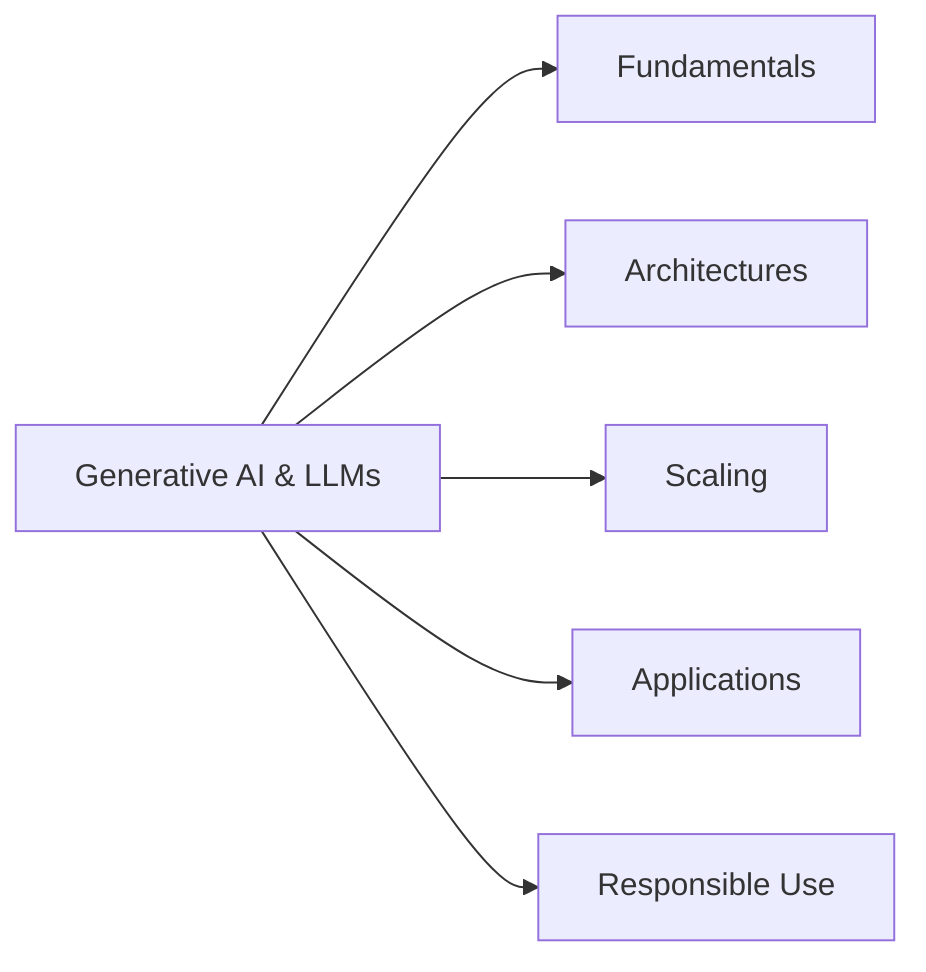
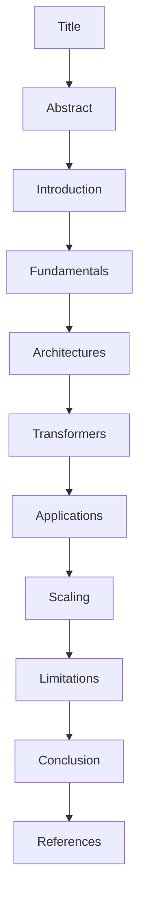
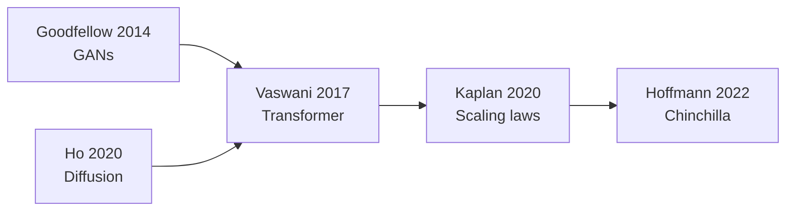
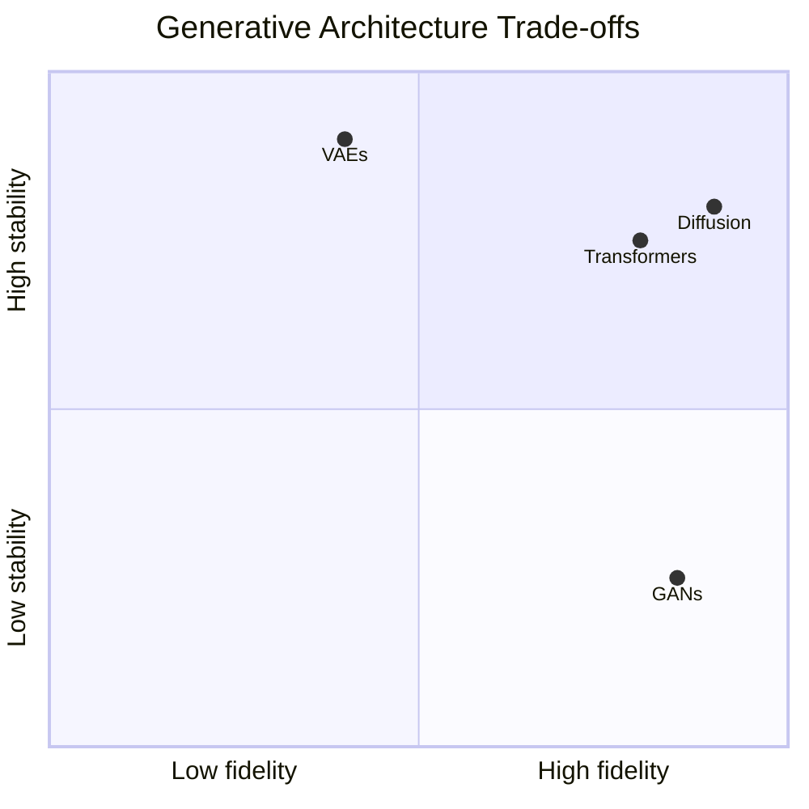
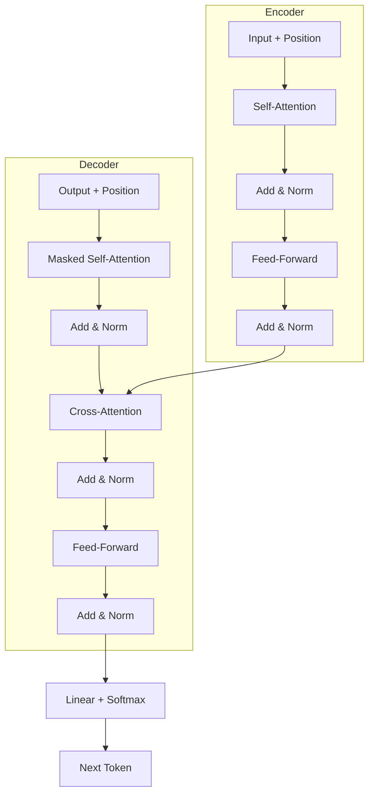
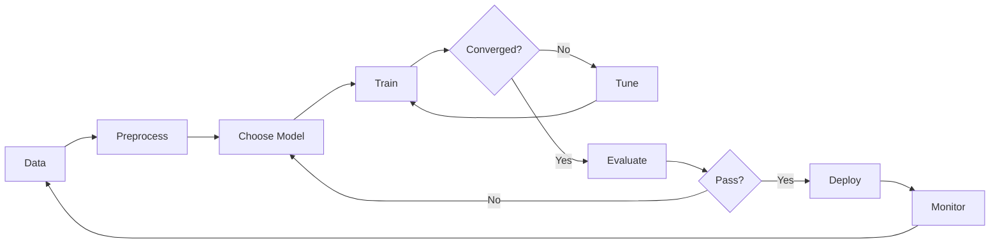
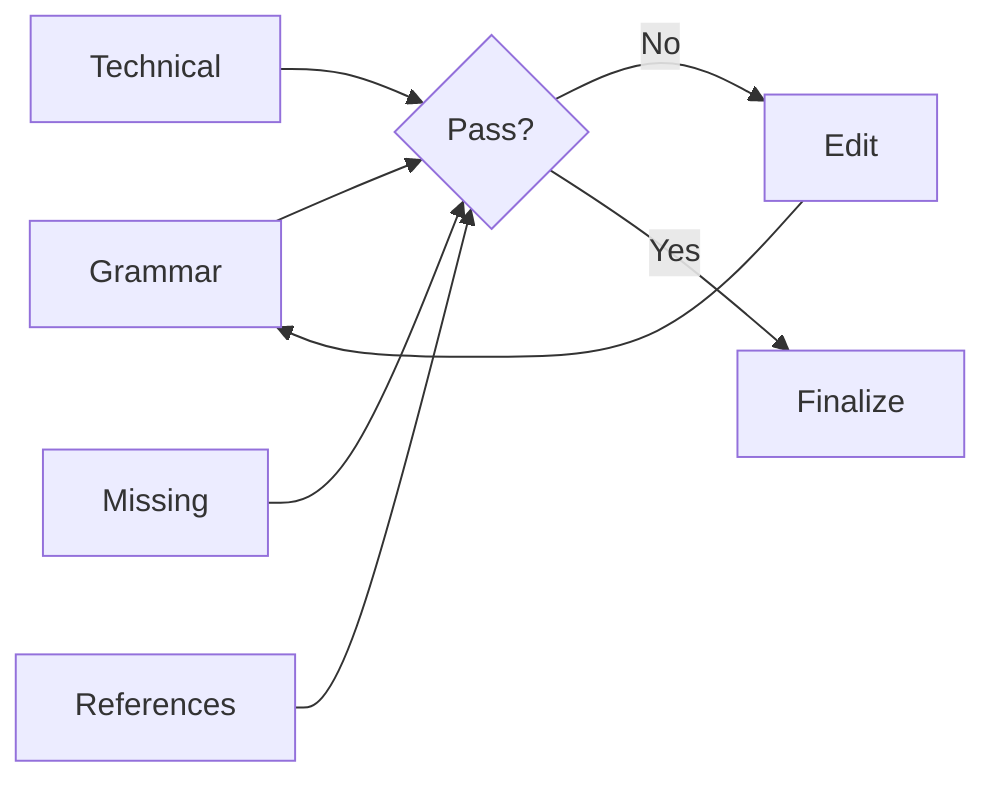
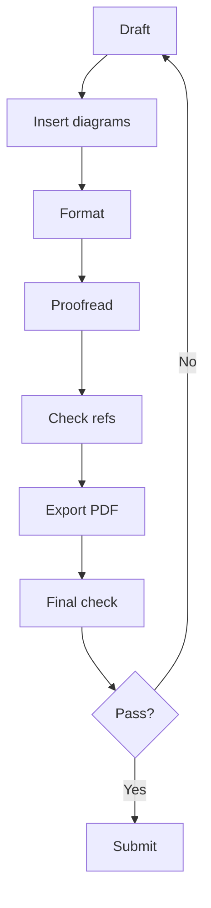

# Aim:	Comprehensive Report on the Fundamentals of Generative AI and Large Language Models (LLMs)
Experiment:
Develop a comprehensive report for the following exercises:

1.	Explain the foundational concepts of Generative AI.  
2.	Focusing on Generative AI architectures. (like transformers).
3.	Generative AI applications.
4.	Generative AI impact of scaling in LLMs.

# Algorithm:
## Step 1: Define Scope and Objectives:

1.1 Identify the goal of the report (e.g., educational, research, tech overview)

1.2 Set the target audience level (e.g., students, professionals)

1.3 Draft a list of core topics to cover

## Step 2: Create Report Skeleton/Structure:

2.1  Title Page

2.2  Abstract or Executive Summary

2.3  Table of Contents

2.4 Introduction

2.5 Main Body Sections:

•	Introduction to AI and Machine Learning

•	What is Generative AI?

•	Types of Generative AI Models (e.g., GANs, VAEs, Diffusion Models)

•	Introduction to Large Language Models (LLMs)

•	Architecture of LLMs (e.g., Transformer, GPT, BERT)

•	Training Process and Data Requirements

•	Use Cases and Applications (Chatbots, Content Generation, etc.)

•	Limitations and Ethical Considerations

•	Future Trends


2.6 Conclusion

2.7 References
________________________________________
## Step 3: Research and Data Collection:

3.1 Gather recent academic papers, blog posts, and official docs (e.g., OpenAI, Google AI)

3.2 Extract definitions, explanations, diagrams, and examples

3.3 Cite all sources properly
________________________________________
## Step 4: Content Development:

4.1 Write each section in clear, simple language

4.2 Include diagrams, figures, and charts where needed

4.3 Highlight important terms and definitions

4.4 Use examples and real-world analogies for better understanding
________________________________________
## Step 5: Visual and Technical Enhancement:

5.1 Add tables, comparison charts (e.g., GPT-3 vs GPT-4)

5.2 Use tools like Canva, PowerPoint, or LaTeX for formatting

5.3 Add code snippets or pseudocode for LLM working (optional)
________________________________________
## Step 6: Review and Edit:

6.1 Proofread for grammar, spelling, and clarity

6.2 Ensure logical flow and consistency

6.3 Validate technical accuracy

6.4 Peer-review or use tools like Grammarly or ChatGPT for suggestions
________________________________________
## Step 7: Finalize and Export:

7.1 Format the report professionally

7.2 Export as PDF or desired format

7.3 Prepare a brief presentation if required (optional)

# Prompt:
```
Comprehensive Report on the Fundamentals of Generative AI and Large Language Models (LLMs)
Experiment: Develop a comprehensive report for the following exercises:

Explain the foundational concepts of Generative AI.
Focusing on Generative AI architectures. (like transformers).
Generative AI applications.
Generative AI impact of scaling in LLMs.

prompt for each step 
Step 1: Define Scope and Objectives

Act as an academic guide. Define the goal, target audience, objectives, key topics, and learning outcomes for a report on Generative AI and LLMs. Use simple language and bullet points.

Step 2: Create Report Structure

Act as a technical writer. Create a report outline on Generative AI and LLMs, including the title page, abstract, introduction, main topics, conclusion, and references. Briefly describe each section.

Step 3: Research and Data Collection

Act as an AI research assistant. Find five reliable research papers or official sources about Generative AI, Transformers, and LLM scaling. Include titles, authors, years, links, and key findings.

Step 4: Content Development

Act as an AI expert. Explain Generative AI fundamentals, GANs, VAEs, diffusion models, Transformers, applications, and LLM scaling using simple explanations, examples, and a comparison table.

Step 5: Visual and Technical Enhancement

Create a Transformer architecture diagram, a Generative AI workflow flowchart, and a comparison table of GANs, VAEs, diffusion models, and Transformers for my report.

Step 6: Review and Edit

Act as an academic reviewer. Check my Generative AI report for grammar, technical accuracy, missing content, and references. List the issues and suggest corrections. Report: [Paste text].

Step 7: Finalize and Export

Act as a document formatter. Give me a checklist for formatting my Generative AI report, adding diagrams and references, proofreading, and exporting the final document as a PDF.

give me both text output and image for each step
```


# Output(Deep Seek):
### Step 1: Scope and Objectives
Text

Goal: Explain Generative AI and LLMs clearly for students and technical beginners.

Audience: Undergrads, early postgrads, technical professionals.

Objectives: Define GenAI; compare GANs, VAEs, diffusion, Transformers; explain LLM scaling; list applications and risks.

Key topics: Fundamentals, architectures, Transformer mechanics, scaling laws, applications, responsible use.

Outcomes: Reader can explain GenAI, compare architectures, describe self-attention, interpret scaling laws, and identify risks.

Image


### Step 2: Report Structure
Text

Title Page

Abstract

Introduction

Foundational Concepts

Architectures: GANs, VAEs, Diffusion, Transformers

Transformer Deep Dive

Applications

Impact of Scaling in LLMs

Limitations and Responsible Use

Conclusion

References

Appendix (optional)

Image



### Step 3: Research Sources
Text

Vaswani et al. (2017), Attention Is All You Need — Transformer uses self-attention; more parallelizable than RNNs.
https://arxiv.org/abs/1706.03762

Goodfellow et al. (2014), Generative Adversarial Networks — Generator vs. discriminator adversarial training.
https://arxiv.org/abs/1406.2661

Ho et al. (2020), Denoising Diffusion Probabilistic Models — High-quality generation by reversing noise.
https://arxiv.org/abs/2006.11239

Kaplan et al. (2020), Scaling Laws for Neural Language Models — Loss follows power laws with model/data/compute.
https://arxiv.org/abs/2001.08361

Hoffmann et al. (2022), Training Compute-Optimal Large Language Models — Scale model size and tokens equally; Chinchilla 70B beats larger models.
https://arxiv.org/abs/2203.15556

Image


### Step 4: Content Development
Text

Generative AI: Models learn data distribution and sample new data. Main types: GANs, VAEs, diffusion, autoregressive Transformers.

GANs: Generator makes fakes; discriminator detects fakes. Sharp images, unstable training.

VAEs: Encode to latent space, decode to data. Stable, smooth latent space, blurrier outputs.

Diffusion: Add noise, learn to remove it. High quality, slow sampling.

Transformers: Self-attention captures long-range context. Backbone of modern LLMs.

Applications: Text, image, audio, code, multimodal.

Scaling: Kaplan: loss follows power laws. GPT-3: scale enables few-shot learning. Chinchilla: scale parameters and tokens equally.

Comparison: GANs = sharp/unstable; VAEs = stable/blurry; Diffusion = high quality/slow; Transformers = scalable/general but hallucination risk.

Image



### Step 5: Visual and Technical Enhancement

Text
Use three visuals: Transformer diagram, GenAI workflow, architecture comparison table.

Image 1 — Transformer Architecture


Image 2 — Generative AI Workflow



| Model | Strength | Weakness |
|---|---|---|
| **GANs** | Sharp images | Unstable; mode collapse |
| **VAEs** | Stable; latent space | Blurry outputs |
| **Diffusion** | High quality | Slow sampling |
| **Transformers** | Scalable; general | Compute cost; hallucination |


### Step 6: Review and Edit

Text
Check:

Grammar: define acronyms; consistent tense; avoid anthropomorphism.

Accuracy: Transformer = no recurrence; GAN = implicit model; Chinchilla = equal scaling; diffusion = iterative.

Missing: evaluation metrics, one example per architecture, positional encoding, multimodal note.

References: cite all five in text; use stable links; APA style.

Image



### Step 7: Finalize and Export
Text
Checklist:

Format: 1-inch margins; consistent font; page numbers; heading styles.

Figures: numbered captions; referenced in text; high-resolution diagrams.

References: all cited; alphabetized; APA style; links checked.

Proofread: read aloud; spell-check; verify numbers and names.

PDF: embed fonts; check links; verify TOC and page numbers.

Image

# Result: 

The fundamentals, architectures, applications, and scaling impact of Generative AI and Large Language Models (LLMs) were studied and understood successfully.

